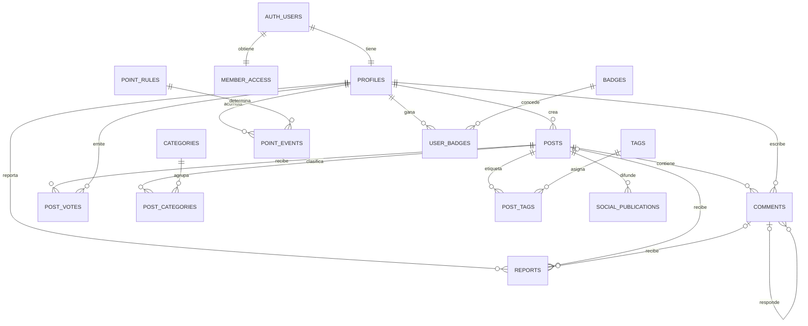

# Modelo de datos inicial — CIAB Community

**Versión:** 1.0 lógico. El borrador DDL/RLS está en `docs/propuestas/` y debe aprobarse antes de integrarlo como migración o ejecutarlo. El bootstrap del primer superadmin está autorizado solo para Supabase local en Docker, mediante un proceso único no expuesto a UI/API.
**Actualizado:** 2026-11-17

## Principios

- PostgreSQL en Supabase es la fuente de verdad; los archivos binarios van a Supabase Storage.
- `auth.users` es administrada por Supabase. No duplicar contraseñas ni almacenar tokens sociales en las tablas de contenido.
- El perfil público se separa del estado/rol de acceso.
- Puntos como libro mayor append-only: el total se calcula desde eventos y, si hay corrección, se inserta un evento compensatorio que referencia al original; no permitir que el navegador actualice un saldo.
- Toda tabla expuesta por API lleva RLS y pruebas de autorización; privilegios y transiciones sensibles se hacen por función/servidor seguro.
- Aplicar al DDL la convención de PK indicada por el usuario; confirmar los nombres físicos al preparar las migraciones.

## Entidades y campos principales

| Tabla | Campos principales | Reglas/relaciones |
| --- | --- | --- |
| `profiles` | `user_id`, `username`, `display_name`, `bio`, `avatar_path`, `created_at`, `updated_at` | `user_id` PK/FK a `auth.users`; `username` único. Solo contiene datos de presentación. |
| `member_access` | `user_id`, `status`, `role`, `approved_by`, `approved_at` | `user_id` PK/FK; `status`: `pending/active/suspended`; `role`: `member/moderator/admin/superadmin`; rol/estado no modificables por el titular. |
| `categories` | `id`, `name`, `slug`, `description`, `is_active` | `slug` único; administrada por admin. |
| `posts` | `id`, `author_id`, `kind`, `title`, `slug`, `excerpt`, `body_md`, `source_url`, `source_class`, `status`, `created_at`, `updated_at`, `published_at` | FK a `profiles`; `kind`: noticia/debate; noticia requiere fuente creíble; `source_class`: `primary/institutional/specialized_media/general_media`; `status`: draft/pending_review/published/hidden/rejected. Solo revisión aprobada la hace pública. |
| `post_categories` | `post_id`, `category_id` | PK compuesta; relaciones N:M. |
| `tags` | `id`, `name`, `slug` | `slug` único; catálogo moderado o con creación controlada. |
| `post_tags` | `post_id`, `tag_id` | PK compuesta; relaciones N:M. |
| `comments` | `id`, `post_id`, `author_id`, `parent_id`, `body`, `status`, `created_at`, `updated_at` | Se publica al enviarse, sin aprobación previa; `parent_id` opcional para respuestas de un nivel; `status`: `published/hidden/deleted`, con moderación posterior. |
| `post_votes` | `post_id`, `user_id`, `value`, `created_at` | PK/UNIQUE (`post_id`,`user_id`); una reacción por persona/publicación; no autorreacción. |
| `point_rules` | `id`, `action`, `version`, `points`, `daily_cap`, `is_active`, `created_at` | UNIQUE (`action`,`version`); una versión usada no se edita: se crea otra. Valores y topes iniciales aprobados en RF. |
| `point_events` | `id`, `user_id`, `point_rule_id`, `reference_type`, `reference_id`, `points`, `idempotency_key`, `created_at`, `reversal_of_event_id` | FK a perfil/regla; `points` conserva el valor aplicado; `idempotency_key` único; las correcciones son eventos compensatorios y el historial no se borra. |
| `levels` | `id`, `code`, `name`, `minimum_points`, `sort_order`, `is_active` | `code` único; nivel calculado por el umbral más alto. Iniciales: 0, 20, 75 y 200 puntos. |
| `badges` | `id`, `code`, `name`, `description`, `rule_config`, `is_active` | `code` único; `rule_config` versionado/validado. |
| `user_badges` | `user_id`, `badge_id`, `awarded_at`, `rule_version` | PK compuesta; concesión única por insignia. |
| `reports` | `id`, `reporter_id`, `post_id`, `comment_id`, `reason`, `status`, `created_at`, `resolved_by`, `resolved_at` | Debe referirse exactamente a una publicación o comentario; evita reportar sin objetivo. |
| `moderation_actions` | `id`, `actor_id`, `target_type`, `target_id`, `action`, `reason`, `created_at` | Auditoría append-only de aprobación, rechazo, ocultar, eliminar/restaurar y resolución de reportes por roles autorizados. |
| `social_publications` | `id`, `post_id`, `provider`, `status`, `scheduled_at`, `attempt_count`, `external_id`, `last_error`, `published_at` | Entidad prevista para fase 2; outbox/cola para el worker; UNIQUE (`post_id`,`provider`); secretos viven en variables de Railway, no en BD. |

## Relaciones principales

## Índices y restricciones a considerar en la migración

- Índices para `posts(status, published_at DESC)`, `posts(author_id, created_at DESC)`, `comments(post_id, created_at)`, y votos por publicación.
- `CHECK` para enumeraciones, `value`, fuente obligatoria en noticia, y exactamente un objetivo en `reports`.
- Restricción única para `username`, slug, voto por usuario/publicación, `idempotency_key` y publicación por canal.
- Paginación por cursor (fecha + ID) para feeds; no calcular ranking con un conteo completo en cada solicitud si crece el volumen.

## Matriz inicial de acceso

| Recurso/acción | Público | Pendiente | Activo | Moderador | Admin | Superadmin |
| --- | --- | --- | --- | --- | --- | --- |
| Perfiles públicos | Leer datos públicos | Leer | Leer | Leer | Leer | Leer |
| Publicaciones aprobadas | Leer | Leer | Leer | Leer | Leer | Leer |
| Crear noticia/debate | No | No | Enviar a revisión | Enviar a revisión | Enviar a revisión | Enviar a revisión |
| Aprobar/rechazar publicaciones | No | No | No | Sí | Sí | Sí |
| Leer comentarios visibles | Leer | Leer | Leer | Leer | Leer | Leer |
| Crear comentario | No | No | Sí, inmediato | Sí, inmediato | Sí, inmediato | Sí, inmediato |
| Ocultar/eliminar/restaurar comentario | No | No | No | Sí | Sí | Sí |
| Leer/gestionar estado propio | No | Leer propio | Leer propio | Leer propio | Gestionar membresías | Gestionar |
| Otorgar/revocar roles privilegiados | No | No | No | No | No | Sí, con auditoría |
| Votos/puntos | No | Sin escritura | Flujo autorizado; consultar solo lo permitido | Auditar | Auditar | Auditar |
| Cola social (fase 2) | Sin acceso | Sin acceso | Sin acceso | Sin acceso | Ver estado | Ver estado; worker protegido |

La política SQL concreta debe evitar que un usuario se otorgue rol, estado de miembro, puntos o insignias, y evitar que el worker exponga su clave de servicio en el navegador.
