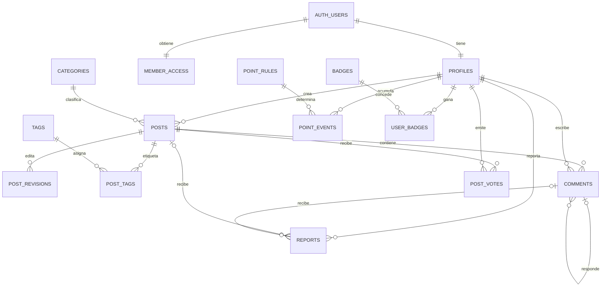

# Modelo de datos — CIAB Community

**Versión:** borrador 0.3. El DDL está en `supabase/migrations/20261110000000_esquema_inicial.sql` y pasa 74 comprobaciones de permisos y puntos (ver "Entornos y pruebas"). Se aplica a Supabase solo cuando el equipo apruebe RF v1.

## Principios

- PostgreSQL en Supabase es la fuente de verdad; los archivos binarios van a Supabase Storage.
- `auth.users` es administrada por Supabase. No se duplican contraseñas ni se guardan tokens sociales en tablas de contenido.
- El perfil público (`profiles`) está separado del estado y rol de acceso (`member_access`).
- Toda tabla de `public` tiene RLS. El cliente solo escribe lo suyo; las transiciones privilegiadas (aprobar, publicar, ocultar, otorgar puntos) pasan por funciones `SECURITY DEFINER` que validan el rol por dentro.
- Los puntos son un libro mayor de solo-agregar: el total se calcula sumando eventos; las correcciones son eventos compensatorios. Nadie actualiza un saldo.

## Entidades

| Bloque | Tabla | Campos principales | Reglas y relaciones |
| --- | --- | --- | --- |
| Identidad | `profiles` | `user_id`, `username`, `display_name`, `bio`, `avatar_path` | PK/FK a `auth.users`. `username` único, `^[a-z0-9_]{3,30}$`. Solo datos de presentación. |
| Identidad | `member_access` | `user_id`, `status`, `role`, `status_reason`, `approved_by`, `approved_at` | Se crea sola al registrarse (`pending`/`member`). `status`: pending/active/suspended; `role`: member/moderator/admin. El cliente no puede escribirla. |
| Catálogos | `categories` | `id`, `name`, `slug`, `description`, `sort_order`, `is_active` | `slug` único. Datos iniciales: las 7 categorías de P-03. |
| Catálogos | `tags` | `id`, `name`, `slug` | `slug` único; las crea un admin. |
| Publicaciones | `posts` | `id`, `author_id`, `kind`, `category_id`, `title`, `excerpt`, `body_md`, `source_url`, `status`, `rejection_reason`, `support_count`, `reviewed_by`, `reviewed_at`, `published_at` | `kind`: news/debate. Noticia exige `source_url` `https://`. `status`: draft/pending_review/published/rejected/hidden. Una categoría por publicación (RF-04). El autor no puede tocar campos de revisión ni contadores. |
| Publicaciones | `post_revisions` | `id`, `post_id`, `editor_id`, `title`, `excerpt`, `body_md`, `source_url`, `status`, `review_reason` | Edición de algo ya publicado (P-04). Al aprobarse reemplaza el contenido visible; el historial se conserva. |
| Publicaciones | `post_tags` | `post_id`, `tag_id` | PK compuesta. |
| Conversación | `comments` | `id`, `post_id`, `author_id`, `parent_id`, `body`, `status`, `is_highlighted`, `highlighted_by` | `status`: visible/hidden/deleted. Respuestas de un nivel y en la misma publicación (trigger). Edición del texto solo 15 minutos. |
| Conversación | `post_votes` | `post_id`, `user_id`, `created_at` | PK (`post_id`, `user_id`): un apoyo por persona. No autoapoyo (trigger). Mantiene `posts.support_count`. |
| Moderación | `reports` | `id`, `reporter_id`, `post_id`, `comment_id`, `reason`, `details`, `status`, `resolved_by` | Exactamente un objetivo (`CHECK`). Un reporte por persona y objetivo. 3 reportes abiertos de personas distintas ocultan un comentario (P-02). |
| Moderación | `moderation_actions` | `id`, `moderator_id`, `target_type`, `target_id`, `action`, `reason`, `created_at` | Auditoría de solo-agregar. `moderator_id` nulo = acción automática. |
| Gamificación | `point_rules` | `id`, `action`, `version`, `points`, `daily_cap`, `per_target_cap`, `is_active` | Una sola versión activa por acción. Una versión usada no se edita: se crea otra. |
| Gamificación | `point_events` | `id`, `user_id`, `point_rule_id`, `reference_type`, `reference_id`, `points`, `idempotency_key`, `reversal_of_event_id` | `idempotency_key` única. El cliente no puede insertar. |
| Gamificación | `levels` | `id`, `code`, `name`, `minimum_points` | Umbrales de P-01. El nivel actual es el umbral más alto alcanzado. |
| Gamificación | `badges`, `user_badges` | `code`, `name`, `description`, `rule_config` / `user_id`, `badge_id`, `rule_version`, `awarded_at` | Concesión única por insignia. La asignación automática se implementa en la fase 5. |
| Fase 2 | `social_publications` | `id`, `post_id`, `provider`, `status`, `scheduled_at`, `attempt_count`, `external_id`, `last_error` | **No está en la migración inicial.** Outbox para el worker de Railway; UNIQUE (`post_id`, `provider`); secretos en variables de Railway. |

## Relaciones

## Funciones que llama el cliente (RPC)

| Función | Quién | Qué hace |
| --- | --- | --- |
| `set_member_status(user, status, reason)` | Admin | Aprueba, suspende o reactiva; exige motivo para suspender; no sobre sí mismo. |
| `set_member_role(user, role)` | Admin | Cambia rol; no sobre sí mismo. |
| `moderate_post(post, decision, reason, is_spam)` | Moderador/admin | `publish`, `reject`, `hide`, `restore`. Otorga o retira puntos. |
| `review_post_revision(revision, approve, reason)` | Moderador/admin | Aprueba o rechaza una edición. |
| `set_comment_status(comment, status, reason)` | Moderador/admin | Oculta o restaura un comentario y ajusta puntos. |
| `highlight_comment(comment)` | Moderador o autor de la publicación | Destaca un comentario ajeno y otorga puntos. |
| `resolve_report(report, accept)` | Moderador/admin | Cierra un reporte; si se confirma, puntos al reportante. |
| `get_leaderboard(period, limit)` | Público | Ranking `month` o `all`; solo usuario, nombre, avatar y puntos. |

Las funciones internas (`award_points`, `reverse_points`, etc.) no se pueden llamar desde el cliente.

## Cómo funcionan los puntos

1. Una acción validada (publicar, apoyo de miembro con 7+ días, destacar, confirmar reporte) llama a `award_points` con una clave única, p. ej. `post_approved:<id>`.
2. Si la clave ya existe o se alcanzó el tope diario o por publicación, no pasa nada.
3. Retirar un apoyo inserta un evento negativo que referencia al original.
4. Ocultar contenido, a mano o por 3 reportes, inserta un evento que retira el saldo neto que ese contenido dio a su autor (y −5 si es spam). Restaurarlo inserta el evento inverso. Estos ajustes usan la regla técnica `content_withheld`, así que no cuentan en los topes diarios ni por publicación.
5. Nadie modera, revisa ni reporta lo propio: un moderador no publica ni restaura su publicación, no modera su comentario, no revisa su edición y no resuelve su reporte.
6. Un apoyo solo se retira mientras la publicación está publicada. Si estuviera oculta, su punto ya se descontó al ocultarla.
7. Las reglas de puntos no se editan: el admin crea una versión nueva y activa o desactiva las existentes.

## Índices y restricciones

- Índices: `posts(status, published_at desc, id desc)` para el feed con cursor, `posts(category_id, …)`, `posts(author_id, …)`, `comments(post_id, created_at)`, reportes abiertos, `point_events(user_id, …)` y por referencia.
- `CHECK` para enumeraciones, longitudes, formato de `username` y `slug`, fuente `https` obligatoria en noticias y objetivo único en reportes.
- Límites antiabuso por trigger: 5 publicaciones/día, 10 comentarios/hora, 10 reportes/día (RNF-05).
- Ranking: `get_leaderboard` suma eventos en cada consulta; si el volumen crece, pasar a vista materializada (RNF-06).

## Matriz de acceso

| Recurso | Visitante | Miembro pending | Miembro active | Moderador | Admin |
| --- | --- | --- | --- | --- | --- |
| Perfiles | Leer | Leer; editar el suyo | Leer; editar el suyo | Leer | Leer |
| Publicaciones `published` | Leer | Leer | Leer; crear borradores y enviar a revisión | Leer y moderar | Leer y moderar |
| Publicaciones propias no publicadas | — | Leer | Leer y editar | Leer todas | Leer todas |
| Comentarios visibles | Leer | Leer | Leer, crear, editar 15 min, borrar los suyos | Leer todos y moderar | Leer todos y moderar |
| Apoyos | Ver el total | — | Dar y retirar el suyo | Igual que miembro | Igual que miembro |
| Reportes | — | — | Crear y ver los suyos | Ver todos y resolver | Ver todos y resolver |
| `member_access` | — | Leer la suya | Leer la suya | Leer todas | Gestionar (no la propia) |
| Eventos de puntos | Ranking agregado | Ver los suyos | Ver los suyos | Auditar | Auditar |
| Categorías, etiquetas, reglas | Leer | Leer | Leer | Leer | Gestionar |

## Entornos y pruebas

`scripts/probar-esquema.mjs` recorre el flujo completo con 6 usuarios en 74 comprobaciones: aprobación, publicación, apoyos, comentarios, destacados, ocultar/restaurar, spam, reportes, ocultamiento automático, etiquetas, reglas de puntos y ranking. También verifica los intentos que deben fallar: autoaprobarse, autopublicarse, autoapoyarse, moderar o reportar lo propio, editar reglas, insertarse puntos o llamar funciones internas.

| Dónde | Cómo | Para qué |
| --- | --- | --- |
| Tu PC | `npm install` y `npm run test:db` | PGlite: Postgres en memoria que simula `auth.users`, `auth.uid()` y los roles de Supabase. No necesita Docker. |
| GitHub Actions (cada PR) | `.github/workflows/ci.yml` | Corre lo mismo con PGlite y además contra el Postgres real de Supabase (`supabase db start`, con Docker en el runner) y hace `supabase db lint`. |
| Supabase en la nube (desarrollo) | Proyecto gratuito propio | Probar el Auth real y la RLS desde la app. |

El script se conecta a un Postgres real si defines `DATABASE_URL`, que es lo que usa el CI. Inserta datos de prueba, así que úsalo solo contra una base desechable y nunca contra staging ni producción.

### Proyecto de Supabase para desarrollo (sin Docker)

El CLI corre con `npx` sin instalarlo. Los comandos `link` y `db push` trabajan contra la nube y no usan Docker.

1. Crea un proyecto en [supabase.com](https://supabase.com/dashboard) (el plan gratuito permite 2 proyectos activos).
2. Copia `.env.example` como `.env.local` y completa la URL y las claves (Project Settings → API).
3. Aplica la migración por cualquiera de estos caminos:
   - pega `supabase/migrations/20261110000000_esquema_inicial.sql` en el SQL Editor y ejecútalo, o
   - `npx supabase login`, `npx supabase link --project-ref <ref>` y `npx supabase db push`.
4. Regístrate desde la app y vuélvete admin con la consulta comentada en `supabase/seed.sql`.

El proyecto institucional de la CIAB se reserva para staging y producción. Solo se aplica cuando el equipo apruebe RF v1.

## Fuera de esta migración

- Políticas de Storage para avatares e imágenes.
- Asignación automática de insignias.
- `social_publications` y el worker de difusión (fase 2).
