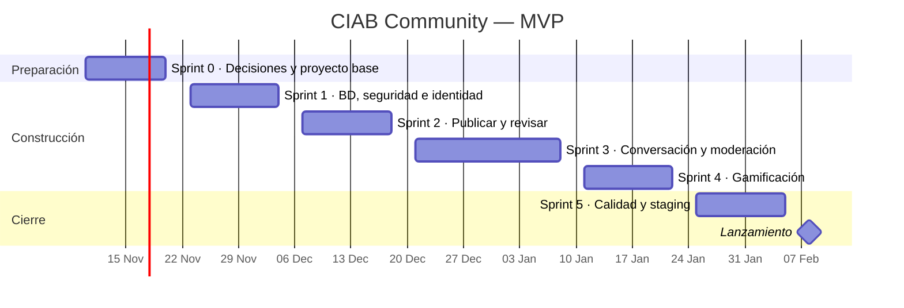

# Plan de ejecución — CIAB Community

**Estado:** borrador 0.3, pendiente de aprobación de Ismael. El esquema de BD ya tiene un borrador probado; la aplicación todavía no se empezó.

## Objetivo

Entregar el MVP de la comunidad de la CIAB: lectura pública, participación de miembros aprobados, noticias y debates con revisión previa, conversación y gamificación basada en aportes validados. Propuesta de lanzamiento: **semana del 8 de febrero de 2027**.

## Supuestos del calendario

- Sprints de 2 semanas desde el **martes 10 de noviembre de 2026**.
- Dedicación estimada de unas **10 horas por semana por persona**. Si es menor, cada sprint se alarga en proporción; el orden no cambia.
- El sprint de fin de año dura 3 semanas por las fiestas.
- Ningún cambio llega a `main` sin PR aprobado por otro colaborador (regla del repositorio).

## Equipo y responsables (propuesta)

| Persona | Rol en el proyecto | Frentes principales |
| --- | --- | --- |
| Ismael Rivera | Dirección | Aprobar stack y arquitectura, priorizar alcance, revisar PR, cerrar cada fase. |
| Diego | Desarrollo | Base de datos, RLS, funciones de moderación y puntos, despliegue y CI. |
| Vladimir | Desarrollo | Interfaz: feed, publicación, detalle, perfiles, ranking y accesibilidad. |

El panel de moderación y las pruebas de flujo se hacen en pareja. Confirmar con Vladimir qué frente prefiere.

## Calendario

## Sprints, entregables y criterios de salida

| Sprint | Fechas | Trabajo | Responsables | Criterio de salida |
| --- | --- | --- | --- | --- |
| 0 · Decisiones y proyecto base | 10–20 nov 2026 | Aprobar P-01 a P-05 y el stack; crear la app, lint, tipos, CI, plantilla `.env.example` sin secretos; proyecto Supabase institucional. | Ismael (decisiones), Diego (CI y Supabase), Vladimir (app base y maquetas). | RF v1 aprobados; la app compila en CI; accesos de Vercel, Railway y Supabase confirmados. |
| 1 · BD, seguridad e identidad | 23 nov – 4 dic | Aplicar la migración en un proyecto Supabase de desarrollo (nube, sin Docker) y en staging; pruebas de permisos en CI con PGlite y con Supabase real; registro, inicio de sesión, perfil; pantalla "membresía pendiente"; panel de aprobación de miembros. | Diego (BD y CI), Vladimir (pantallas). | Las pruebas de permisos pasan en los dos jobs del CI; un admin aprueba a un miembro de punta a punta. |
| 2 · Publicar y revisar | 7–18 dic | Formularios de noticia y debate, envío a revisión, cola de moderación, publicar/rechazar con motivo, feed paginado con filtros, página de detalle. | Vladimir (feed y formularios), Diego (cola de moderación y consultas). | Ningún borrador ni pendiente aparece al público; lo aprobado sí, con su fuente. |
| 3 · Conversación y moderación | 21 dic 2026 – 8 ene 2027 | Comentarios y respuestas, apoyos, reportes, ocultar/restaurar, edición con revisión, registro de auditoría visible para moderadores. | Ambos (en pareja). | Flujos de RF-05 a RF-08 funcionan; las acciones de moderación quedan registradas. |
| 4 · Gamificación | 11–22 ene | Puntos y nivel en el perfil, ranking mensual e histórico, asignación de insignias, panel de reglas para admin. | Diego (insignias y ranking), Vladimir (perfil y ranking). | Totales coinciden con el libro mayor; reintentos no duplican puntos; topes respetados. |
| 5 · Calidad y staging | 25 ene – 5 feb | Pruebas de flujo, accesibilidad, móvil, rendimiento con datos semilla, aviso de privacidad, respaldo y restauración probados, despliegue en staging. | Ambos; Ismael valida. | Sin hallazgos críticos de autorización; RNF verificados; guía de despliegue y rollback escrita. |
| Lanzamiento | semana del 8 feb 2027 | Despliegue en producción, dominio, primeros moderadores y admins, primeras categorías. | Ismael y equipo. | Smoke tests en producción; secretos fuera del cliente y de Git. |

## Fase 2 — Difusión social (después del lanzamiento)

Definir canales, cuentas y aprobación editorial; crear `social_publications` (outbox) y el worker en Railway con reintentos e idempotencia. Se planifica cuando el MVP tenga uso real.

## Fuera del MVP

Difusión automática en redes, mensajes privados, notificaciones en tiempo real, moderación automática con IA y app móvil nativa. No se añade otra base de datos ni una cola independiente hasta que exista una necesidad comprobada.

## Riesgos

- **Stack sin aprobar:** si Ismael elige otro stack, se reajusta el sprint 0; la migración y las pruebas no cambian.
- **Accesos institucionales:** sin el proyecto Supabase de la CIAB no se puede pasar a staging; pedirlo en el sprint 0.
- **Dedicación:** con menos de 10 h/semana por persona, el lanzamiento se mueve a marzo. Recortar primero insignias y edición con revisión antes que moderación.
- **Fiestas de fin de año:** el sprint 3 puede rendir menos; por eso dura 3 semanas.

## Puntos de aprobación

1. Ismael aprueba stack, arquitectura y este plan.
2. Equipo aprueba P-01 a P-05 (`02-requisitos-funcionales.md`).
3. Accesos de Vercel, Railway y Supabase disponibles antes del sprint 1.
4. Cada sprint cierra con demo y aprobación antes de avanzar.

## Referencias técnicas

- [Next.js — Deploying](https://nextjs.org/docs/app/getting-started/deploying)
- [Railway — Deploy a Next.js app](https://docs.railway.com/guides/nextjs)
- [Vercel — Next.js](https://vercel.com/docs/frameworks/full-stack/nextjs)
- [Supabase — Local development workflow and migrations](https://supabase.com/docs/guides/local-development/cli-workflows)
- [Supabase — Row Level Security](https://supabase.com/docs/guides/database/postgres/row-level-security)
- [Supabase — Storage access control](https://supabase.com/docs/guides/storage/security/access-control)
